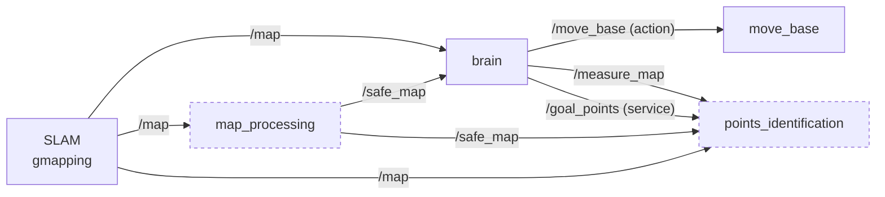

# awm

ROS Noetic package that makes a TurtleBot3 (Gazebo simulation or real robot) cover a map with measurements: it maps the area with SLAM, drives to the next place that has not been measured yet, stands still to take a measurement, and repeats until nothing is left. The `brain` node runs the state machine and chooses the goals; `move_base` plans the path and drives.

## How it works



`brain` loops: **MEASURING** (stand still `~measure_duration_s`, write a measurement file, mark the cells around the robot in `/measure_map`) → ask for a goal → **REACHING_GOAL** (`move_base` drives; when it finishes, reached or not, the goal area is marked measured) → MEASURING again → **DONE** when there is no goal left.

How the goal is chosen depends on the launch `mode` (dashed nodes run only in `modular`):

| `mode` | Goal policy | Ends with |
|---|---|---|
| `standalone` (default) | `brain` builds its measure map on `/map` and goes to the closest cell not measured yet. | `EVERYTHING MEASURED` |
| `modular` | `map_processing` turns `/map` into `/safe_map` (with a caution band around walls); `brain` builds its measure map on it and asks `points_identification` for one goal on `/goal_points` in `goal_mode` (default `3` FUSION). | `NO MORE GOAL POINTS` |

`/goal_points` modes: `1` EXPLORATION (frontiers: one goal per cluster of free cells next to unknown space, minus those already measured), `2` MEASUREMENT (nearest unmeasured cells of `/measure_map`), `3` FUSION (MEASUREMENT, then EXPLORATION if that is empty). Goals are in the `map` frame, closest first.

## Quick start

### Native (Ubuntu 20.04 + ROS Noetic)

Install [ROS Noetic](http://wiki.ros.org/noetic/Installation/Ubuntu) (`ros-noetic-ros-base` is enough), then:

```bash
mkdir -p ~/ros_ws/src && git clone https://github.com/PedroSoler10/awm.git ~/ros_ws/src/awm
```

```bash
~/ros_ws/src/awm/scripts/install_deps.sh
```

```bash
cd ~/ros_ws && source /opt/ros/noetic/setup.bash && catkin_make && source devel/setup.bash
```

```bash
export TURTLEBOT3_MODEL=waffle && roslaunch awm awm.launch
```

`install_deps.sh` installs the apt package of every dependency in `package.xml` (`--print` lists them). It avoids `rosdep`, which cannot resolve Noetic keys on newer rosdistro indexes. The TurtleBot3 launch files need `TURTLEBOT3_MODEL` set in every terminal; add the `source` and `export` lines to `~/.bashrc` to make that permanent.

### Docker

Needs Docker (user in the `docker` group), an X server for Gazebo and RViz, and an Intel or AMD GPU (`/dev/dri`). The workspace stays on the host and is mounted into the container.

```bash
mkdir -p ~/shared_ros_ws/src && git clone https://github.com/PedroSoler10/awm.git ~/shared_ros_ws/src/awm
```

```bash
cd ~/shared_ros_ws/src/awm && docker build -t awm:noetic .
```

```bash
xhost +local:root
```

```bash
docker run -it --rm --name awm --net=host --ipc=host --pid=host --device /dev/dri -e DISPLAY=$DISPLAY -v /tmp/.X11-unix:/tmp/.X11-unix:rw -v $HOME/shared_ros_ws:/root/shared_ros_ws awm:noetic
```

Inside the container (ROS, the workspace once built and `TURTLEBOT3_MODEL=waffle` are already loaded):

```bash
cd /root/shared_ros_ws && catkin_make && source devel/setup.bash && roslaunch awm awm.launch
```

- `--net=host --ipc=host --pid=host` let ROS nodes and the GUI work as on the host; `--device /dev/dri`, `DISPLAY` and the X11 socket give the container the screen and the GPU; `--rm` deletes the container on exit (the code lives in the mounted folder).
- A second shell: `docker exec -it awm bash`. Run `xhost -local:root` on the host when you are done.
- Files built in the container belong to root: `sudo chown -R $USER: ~/shared_ros_ws` if needed.
- **Gazebo or RViz crash with `MESA-LOADER` / segfault:** with an NVIDIA GPU replace `--device /dev/dri` by `--gpus all -e NVIDIA_DRIVER_CAPABILITIES=all` (needs the NVIDIA Container Toolkit); without a GPU run `export LIBGL_ALWAYS_SOFTWARE=1` before `roslaunch`.

The VS Code dev container, the helper scripts and debugging are described in [docs/DEVELOPMENT.md](docs/DEVELOPMENT.md).

## Launch

`launch/awm.launch` is the only launch file. Every part can be switched with `name:=value`; `roslaunch awm awm.launch --ros-args` lists them.

```bash
roslaunch awm awm.launch                                  # full simulation
roslaunch awm awm.launch mode:=modular goal_mode:=1       # goals from /goal_points, frontiers only
roslaunch awm awm.launch brain:=false gui:=false rviz:=false  # everything but brain, headless
roslaunch awm awm.launch sim:=false                       # real robot (drivers on this machine)
```

| Argument | Default | Description |
|---|---|---|
| `sim` | `true` | Gazebo simulation; `false` starts the real TurtleBot3 drivers (`turtlebot3_bringup`). |
| `model` | `$TURTLEBOT3_MODEL` or `waffle` | `burger`, `waffle`, `waffle_pi`. `TURTLEBOT3_MODEL` must still be set (any value): the included TurtleBot3 launch files require it. |
| `world` | `turtlebot3_world` | World from `turtlebot3_gazebo/worlds`, without `.world`. Simulation only. |
| `gui` | `true` | Show the Gazebo window. Simulation only. |
| `x_pos`, `y_pos`, `z_pos` | `-2.0`, `-0.5`, `0.0` | Spawn position in meters. Simulation only. |
| `slam`, `slam_method` | `true`, `gmapping` | Run SLAM, and which method of `turtlebot3_slam`. |
| `nav` | `true` | Run `move_base`. There is no AMCL: SLAM already localizes the robot. |
| `move_forward_only` | `false` | Navigation never reverses. |
| `rviz`, `rviz_config` | `true`, `turtlebot3_navigation.rviz` | Open RViz with this configuration. |
| `brain` | `true` | Run `brain`. With `false` it can be started by hand: `rosrun awm brain` (add `_goal_source:=service` in `modular`). |
| `mode` | `standalone` | `standalone` or `modular` (see [How it works](#how-it-works)). Any other value stops the launch. |
| `goal_mode` | `3` | `modular` only: `/goal_points` mode, 1 EXPLORATION, 2 MEASUREMENT, 3 FUSION. |

## Nodes, topics and parameters

| Name | Type | From | To |
|---|---|---|---|
| `/map` | `nav_msgs/OccupancyGrid` | SLAM | `brain` (standalone), `map_processing`, `points_identification` |
| `/safe_map` | `nav_msgs/OccupancyGrid`, latched | `map_processing` | `brain` (modular), `points_identification` |
| `/measure_map` | `nav_msgs/OccupancyGrid`, latched | `brain` | `points_identification` |
| `/scan_pose` | `geometry_msgs/PoseStamped` | `brain` | RViz, tools |
| `/move_base` | `move_base_msgs/MoveBase` action | `brain` (client) | `move_base` (server) |
| `/goal_points` | `awm/GoalPoints` service | `points_identification` (server) | `brain` (modular) |

Map values: SLAM `-1` unknown, `0..100` occupancy. Safe map: `-1` unknown, `0` free, `50` caution, `100` occupied. Measure map: `100` blocked (obstacle, unknown or too close to one), `0` measured, `-1` still to measure.

Private parameters (set with `rosrun awm <node> _name:=value`; `awm.launch` sets only `goal_source` and `goal_mode`):

| Node | Parameter | Default | Meaning |
|---|---|---|---|
| `brain` | `~goal_source` | `internal` | `internal` (standalone search) or `service` (ask `/goal_points`). Other values stop the node. |
| | `~goal_mode` | `3` | `service` only: mode sent to `/goal_points`. Other values stop the node. |
| | `~search_limit_cells` | `200` | `internal` only: farthest goal searched from the robot. |
| | `~measure_duration_s` | `1.0` | Time standing still per measurement. |
| | `~measure_radius_m` | `0.5` | Cells this close to the robot count as measured. |
| | `~inflate_radius_cells` | `6` / `0` | Margin around obstacles (`0` on the safe map: its caution band is the margin). Two defaults: `internal` / `service`. |
| | `~occupied_threshold` | `90` / `49` | Occupancy above this is an obstacle (`49` blocks the caution band). |
| | `~output_dir` | `.` | Folder for the measurement files (`~/.ros` under roslaunch). |
| `map_processing` | `~occupied_threshold` | `90` | From this value up: occupied. |
| | `~caution_threshold` | `50` | From this value up: caution. |
| | `~inflate_radius_cells` | `6` | Free cells within this square radius of an obstacle become caution. |
| | `~dump_maps`, `~dump_dir` | `false`, `.` | Write `map.txt` and `safe_map.txt` on every map. |
| `points_identification` | `~min_cluster_size` | `5` | Smaller frontier clusters are ignored. |
| | `~search_limit_cells` | `200` | Farthest unmeasured cell searched from the robot. |
| | `~dump_maps`, `~dump_dir` | `false`, `.` | Write `map_with_goals.txt` (goals drawn as `8`) on every request. |

Try the service by hand next to the standalone brain: `rosrun awm map_processing`, `rosrun awm points_identification`, then `rosservice call /goal_points "{mode: 1, num: 5}"` (`num: 0` returns all). An unknown mode makes the call fail; missing maps or pose give an empty list.

## Code layout

```
include/awm/, src/lib/   awm_core library (namespace awm): grid helpers, measure map, safe map,
                         frontiers, map text dump, robot pose from tf, brain's goal sources
src/nodes/               brain, map_processing, points_identification (thin: params, topics, calls)
test/                    gtest unit tests of awm_core, no roscore needed
srv/GoalPoints.srv       the /goal_points service
launch/awm.launch        the only launch file
scripts/                 install_deps, check_format, container_build, smoke_test, debug_brain
docs/DEVELOPMENT.md      style, tools, dev container, debugging
```

## Tests

Unit tests (from the workspace, natively or in the container):

```bash
catkin_make run_tests_awm && catkin_test_results build/test_results/awm
```

They cover the grid helpers, measure map, safe map, frontiers and the standalone goal source. `ServiceGoalSource` and the nodes need ROS running and are covered by the smoke test, which runs a headless simulation in the dev container until `brain` has made 3 measurements and prints `PASS` or `FAIL` (see [docs/DEVELOPMENT.md](docs/DEVELOPMENT.md#scripts)):

```bash
scripts/smoke_test.sh mode:=modular
```

## Known limitations

- **The measurement is a placeholder:** an empty file named after the position and time (`<x>_<y>_<time>.txt`).
- **Ring search sampling:** the nearest-cell search samples 360 angles per circle, so beyond about 57 cells (≈2.9 m) it can skip single cells between two samples. They are found once the robot gets closer.
- **The service call blocks brain's loop** until `/goal_points` answers (it waits for the service if `points_identification` is down), so `/scan_pose` pauses meanwhile.
- **No goal timeout:** `brain` relies on `move_base` aborting a goal it cannot reach.
